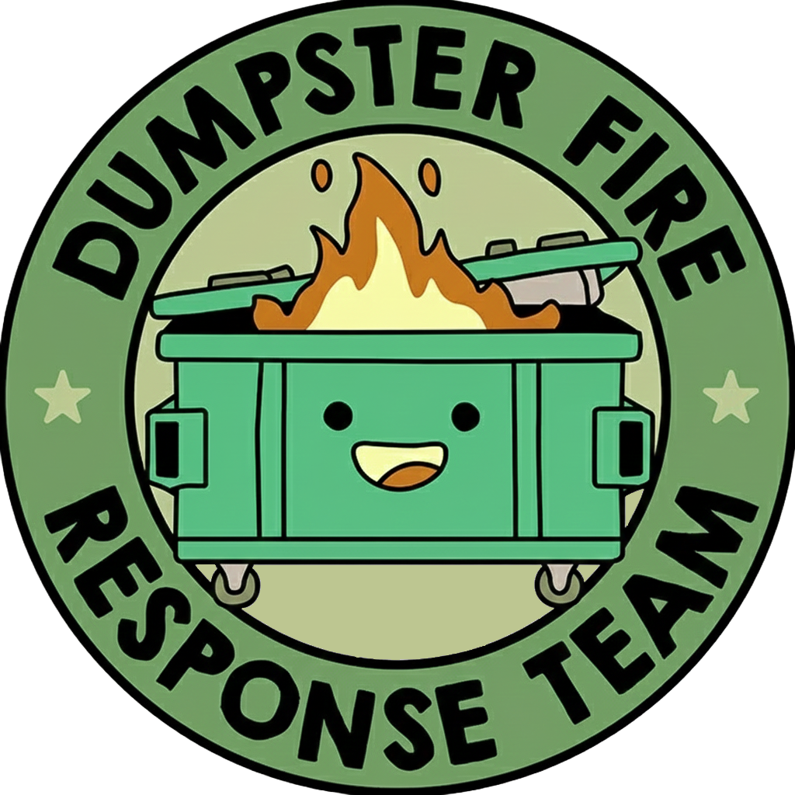

<p align="center">
  
</p>

# 🏠 homelab-docs

[](https://github.com/tronyx/homelab-docs/actions/workflows/ci.yml?query=branch%3Amain)
[](https://docs.chrisyocum.com)
[](https://squidfunk.github.io/mkdocs-material/)
[](https://github.com/tronyx/homelab-docs/commits/main)
[](LICENSE.md)

homelab-docs is the source of [Homelab Docs](https://docs.chrisyocum.com), the public documentation of my homelab. A homelab is a set of computers and network gear that a person runs at home, to learn and to host their own services.

My lab started with my media on external USB drives. Today it fills a 45U rack, with two ESXi hosts, two Unraid servers, dozens of Docker containers and a Kubernetes lab. The site explains how it all fits together, how I keep it up to date, and how it grew. I hope it helps you start a lab of your own, or gives you an idea for the one that you have.

## ✨ What is on the site

- 🏠 Home: how the lab grew and how it helped my career, with a photo of each step and tips on where to start.
- 🖥️ The Main Home Lab: the whole lab on one diagram, with pages for the network, servers, applications, cameras, storage and backups, and rack and power.
- 🔄 Automated Docker Updates: a runbook for reviewed Docker image updates with Forgejo, Renovate and Komodo. It goes from one large compose file to one stack per folder, with weekly backups and the lessons that I learned.
- ☸️ Production-Like GitOps Lab: a Kubernetes platform on eight VMs, built with Terraform and Ansible and run with ArgoCD, explained around one diagram.

## 🚀 Build the site on your computer

You need Python 3 and Git. Clone the repository instead of downloading a ZIP file, because the page dates come from the Git history.

1. Clone the repository, and install the packages into a virtual environment:

   ```bash
   git clone https://github.com/tronyx/homelab-docs.git
   cd homelab-docs
   python3 -m venv .venv
   source .venv/bin/activate
   pip install -r requirements.txt
   ```

   On Windows, type `py` instead of `python3`, and `.venv\Scripts\activate` instead of the `source` line.

2. Start the preview server, and open <http://127.0.0.1:8000>:

   ```bash
   mkdocs serve
   ```

   The preview reloads each time that you save a file.

3. Before you push, build the site the same way that GitHub does:

   ```bash
   mkdocs build --strict
   ```

   `--strict` stops the build at the first warning, such as a link to a page that does not exist.

## ⚙️ How the site is published

Each push to `main` starts the [Deploy MkDocs to GitHub Pages](.github/workflows/ci.yml) workflow. The `build` job runs `mkdocs build --strict`, so a broken link or a bad page stops the deploy. The `deploy` job then publishes the site to GitHub Pages at [docs.chrisyocum.com](https://docs.chrisyocum.com).

## ✍️ How the pages are written

The pages use plain English, in the spirit of [ASD-STE100](https://www.asd-ste100.org/) Simplified Technical English. A reader who is new to homelabs must understand each page on one read:

- 📏 Short sentences: 20 words at most in a procedure, and 25 in a description.
- 👉 One instruction in each step, and the condition before the command: "If the build fails, read the log."
- 🔤 One word for one meaning, and each term defined at its first use.
- 🚫 No filler words, and no "should", "may" or "would". A step that is required says "must".

## 🔒 What the site does not show

The site is public, so it leaves out the private details of my lab. It shows no public IP addresses, passwords, keys, or the names and addresses of family and work devices. Each photo has its metadata removed, and private labels in the older photos are covered.

## 🗺️ The diagrams

The lab diagrams are not drawn by hand. A Python script draws each one from a YAML inventory of the lab. From the same inventory, it renders a public version and a private version. Each cable is one striped ribbon, with one stripe for each VLAN that it carries, and the stripe width shows the link speed. The script and the inventory are in my private repository, and this repository holds a copy of each public render.

## 🙏 Thanks

- [Material for MkDocs](https://squidfunk.github.io/mkdocs-material/) by Martin Donath, the theme of the site.
- [Goblinmine/homelab-diagram](https://github.com/Goblinmine/homelab-diagram), the look of the lab diagrams.

## 🤖 A note on how this was built

Much of this documentation, the diagrams and the home page were written with [Claude](https://claude.ai), Anthropic's AI coding assistant. I described what I needed, gave it the facts about my lab, directed the structure, and asked for changes across many rounds rather than writing most of the pages by hand. I reviewed every page, every diagram and every fact before it went live, because this site describes a lab that I actually run.

I'd rather say that plainly than let it pass as fully hand-written. There's a lot of AI-generated content floating around that hasn't been reviewed and ends up misleading people, and I don't want this to be mistaken for that. If something looks off, please [open an issue](https://github.com/tronyx/homelab-docs/issues).

## 📄 License

The license is MIT. See [LICENSE.md](LICENSE.md).
