

<figure markdown>
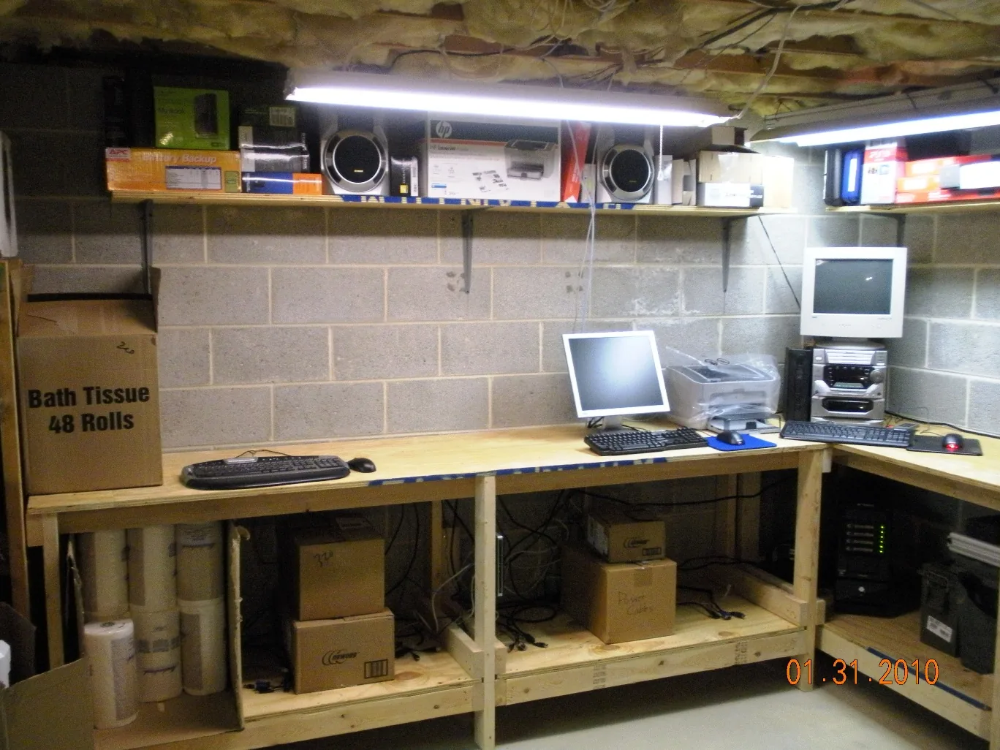{ data-gallery="hero" data-title="The basement workbench, 31 January 2010" }
<figcaption>31 January 2010: the basement workbench</figcaption>
</figure>

<figure markdown>
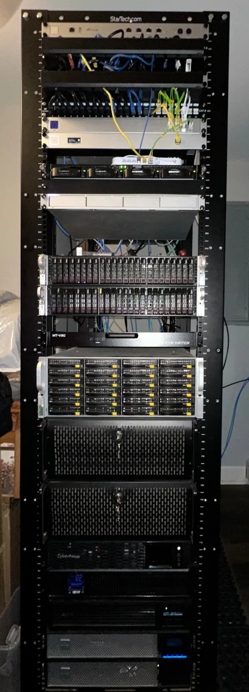{ data-gallery="hero" data-title="The 45U rack today" }
<figcaption>Today: the 45U rack</figcaption>
</figure>

A homelab is a set of computers and network gear that a person runs at home, to learn and to host their own services. This site documents mine. It began with movies and TV shows on external USB drives, and in 2010 with a first file server in my basement. Today it fills a 45U rack, with two ESXi hosts, two Unraid servers, dozens of Docker containers and a Kubernetes lab.

If you are new to homelabs, I hope this page shows how far one old PC can take you. If you already run a lab, I hope you find an idea to take home.

## How the Homelab evolved

Age 14

When I was 14 years old, I put a graphics card in the family computer that I bought from my friend's father, so that I could actually play some video games that required a dedicated graphics card. That is what started everything. That was the moment that I knew I loved computers.

Before 2010

I kept my movies and TV shows on external USB drives on my Windows Vista PC. There was no media server: I watched the files with VLC and kept track of missing TV episodes by hand.

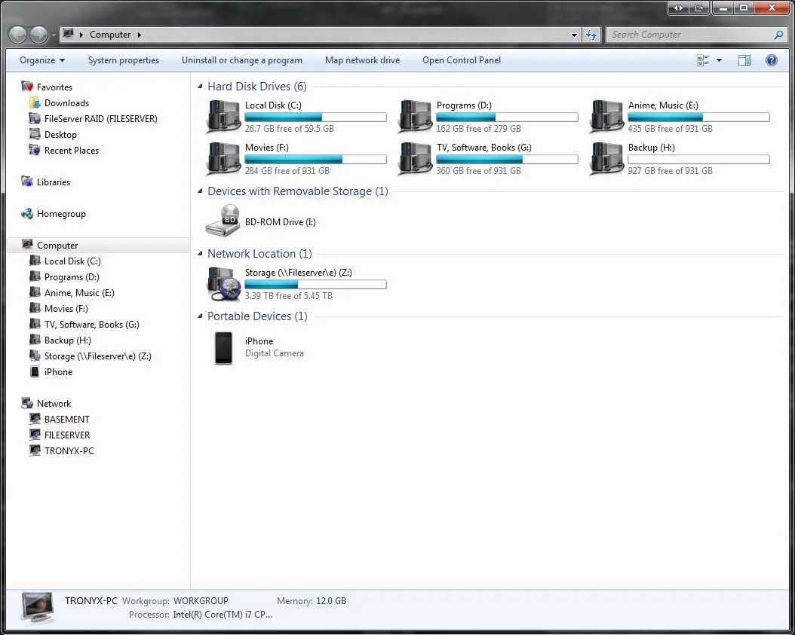{ data-gallery="vista" data-title="My PC's drives, Windows Vista" loading=lazy }

2010

My first file server ran Windows Server 2003 on the tower under the basement workbench.

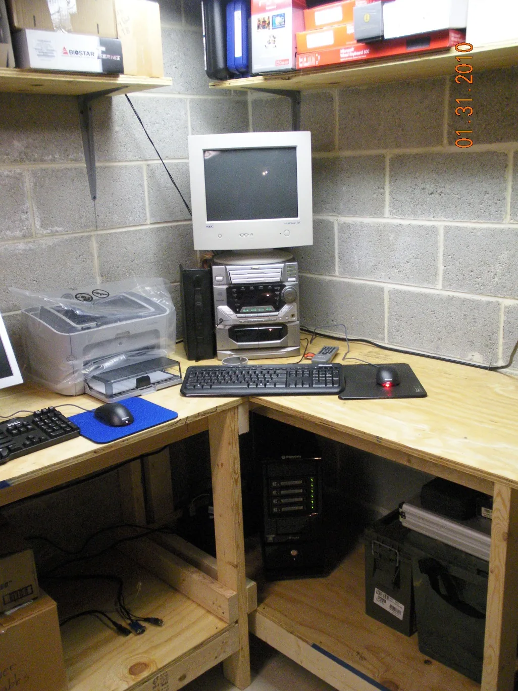{ data-gallery="2010" data-title="The workbench corner, with the file server under the desk, 2010" loading=lazy }

2015

I drew the home network and planned a better one. Then I bought my first rack: an 18U NavePoint cabinet with a Netgear switch and two 4U servers.

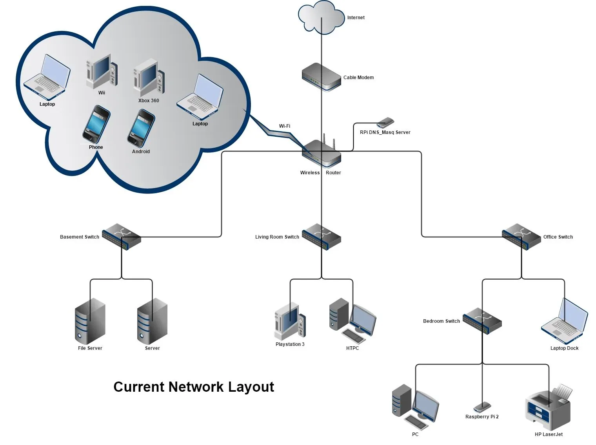{ data-gallery="2015" data-title="The home network before the rack" loading=lazy }
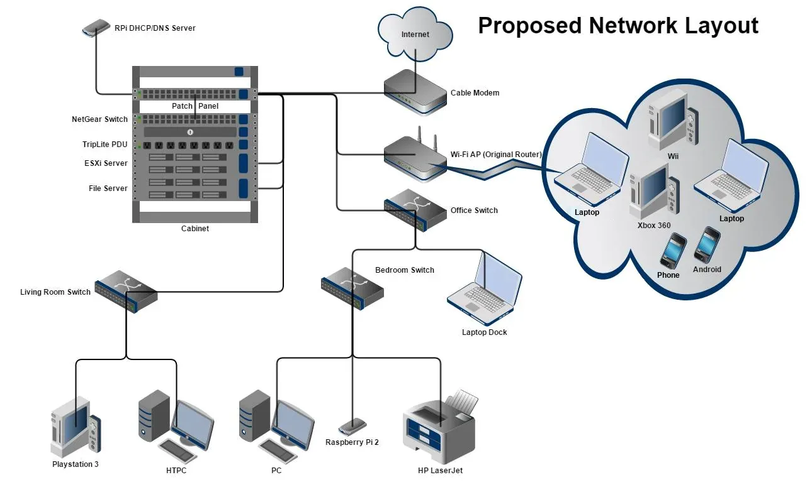{ data-gallery="2015" data-title="The proposed network with the cabinet" loading=lazy }
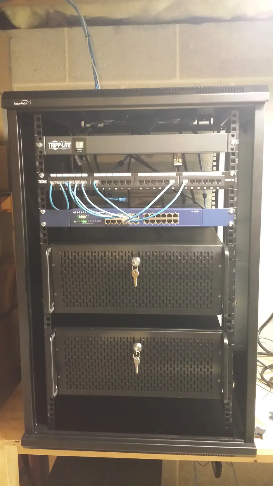{ data-gallery="2015" data-title="The first rack, 14 April 2015" loading=lazy }

2017

Two Netgear ReadyNAS units and a Tripp Lite UPS joined the rack.

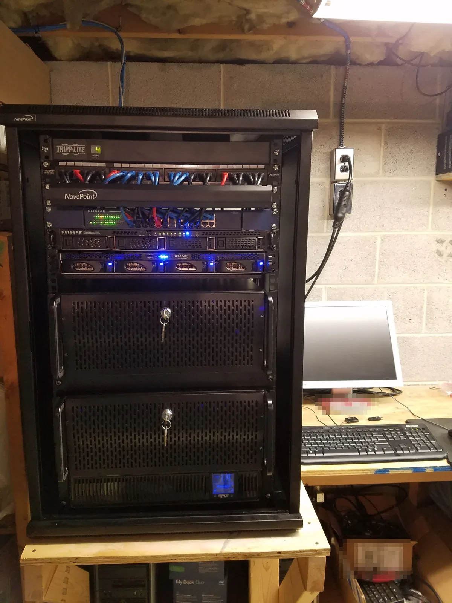{ data-gallery="2017" data-title="ReadyNAS units added, 29 July 2017" loading=lazy }

2018

Two retired HP ProLiant servers brought ESXi and my first VMs. I moved my media apps into Docker with Docker Compose. A Unifi 48-port switch was my first Unifi gear.

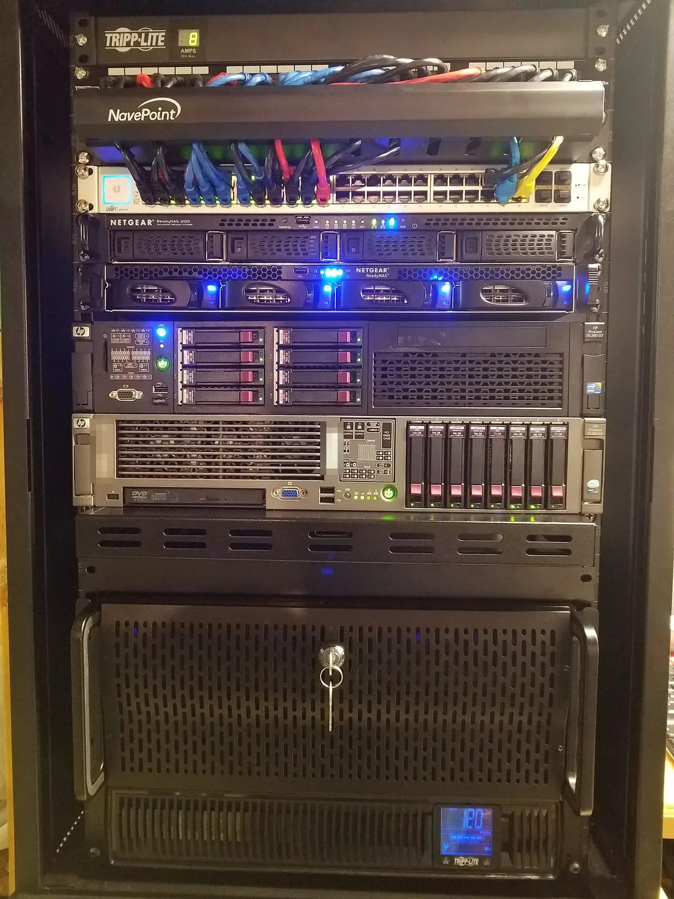{ data-gallery="2018" data-title="HP ProLiant servers and the first Unifi switch, 19 January 2018" loading=lazy }

2020

My media storage passed 100 TB.

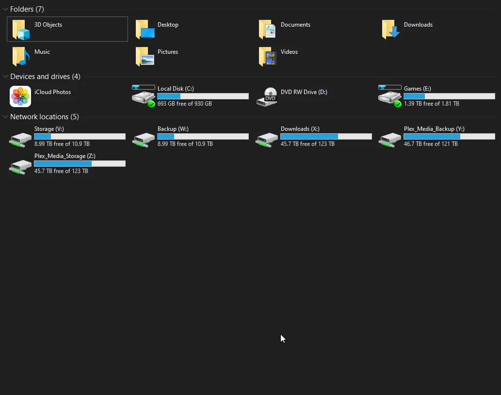{ data-gallery="2020" data-title="More than 100 TB of network storage" loading=lazy }

By 2023

Two Supermicro servers, Sauron and Bolg, replaced the HP servers as ESXi hosts. Two Unraid servers, Morgoth and Gothmog, held the media and its backup. Unifi ran the whole network.

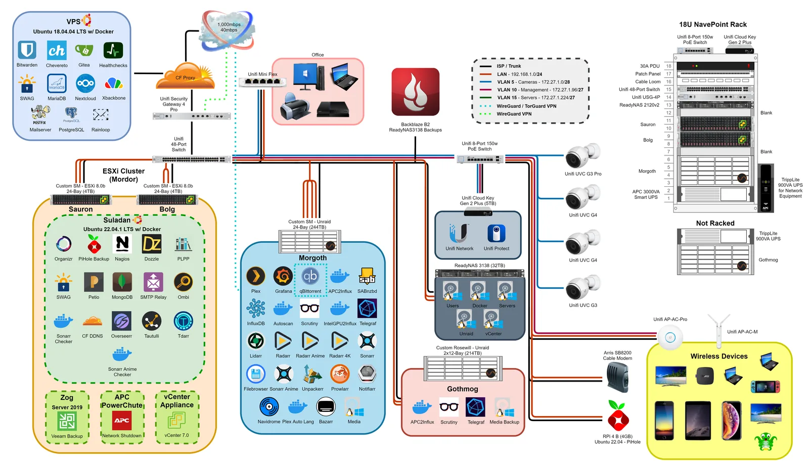{ data-gallery="2023" data-title="The lab diagram, early 2023" loading=lazy }

November 2023

Everything moved into a 45U rack with a 10G aggregation switch.

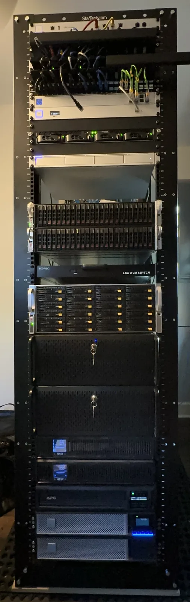{ data-gallery="2023-rack" data-title="The 45U rack, 14 November 2023" loading=lazy }

2026

Git now controls the Docker servers. Renovate proposes each image update in Forgejo, and Komodo deploys it. I also built the GitOps Lab, a Kubernetes platform that I run the way a production team runs one.

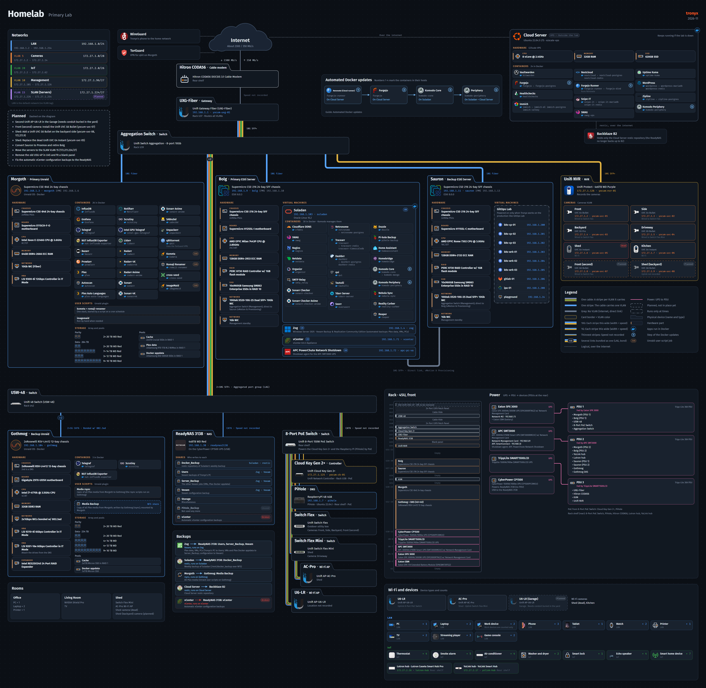{ data-gallery="2026" data-title="The Primary Lab today" loading=lazy }
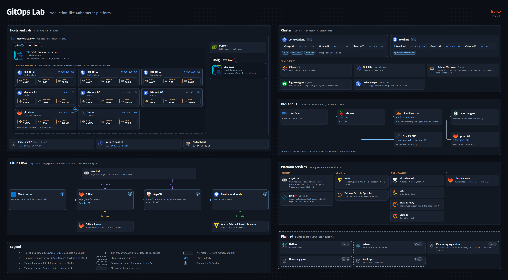{ data-gallery="2026" data-title="The GitOps Lab" loading=lazy }

## How it helped my career evolve

February 2008

I earned Windows certifications through the ComputerTraining.com program. The program also helped with job placement and got me the interview at 1&1 Internet.

2008 to 2014

**1&1 Internet** (now IONOS) · Web Hosting Support Specialist to Shift Supervisor

I started in web hosting support and moved to the Dedicated Server Support Team, where I learned Linux and servers. As Shift Supervisor, I led the third-shift team of second-level support representatives and coached them each month. I took their escalations and worked with the third- and fourth-level administrators to resolve them.

2014 to 2017

**eBay Enterprise** · Command Center Administrator, then Lead

In a 24x7 Command Center, I monitored and supported the production systems for eBay applications, from alert triage to deployments and load tests. As the Lead from 2015, I supervised the releases to production, documented the incident procedures and trained the team. There I learned Nagios, Grafana, InfluxDB and health checks, which all run in my lab today.

2017 to 2025

**Radial** (formerly eBay Enterprise) · DevOps Engineer, then Senior DevOps Engineer

I automated the path from development to production and ran the GoCD pipelines and the configuration management platforms. As a Senior DevOps Engineer from 2019, I containerized applications and helped move them from on-premises servers to AWS and GitLab CI/CD. I also replaced Logstash with Fluent Bit for logging and mentored the team.

2024 to now

**CLY Consulting** · Founder and CEO

I started my own IT consulting company. I designed and built the IT infrastructure for several men's health clinics, a daycare and a mom-and-pop oil and lube shop. I still maintain it.

2025 to 2026

**Iron Mountain** · Systems Engineer, then Senior Systems Engineer

I supported a local imaging center and the central systems of a government project, with on-call duty and strict service levels. I managed the FedRAMP Okta and Cisco Duo instances, the YubiKeys and the laptops for the project staff, and built a team MkDocs site. As a Senior Systems Engineer, I ran the Windows servers and networks and the STIG and SCAP scans for audits.

July 2026 to now

**CardConnect**, a Fiserv company · Senior Systems Engineer

I work with GitOps, Terraform, Ansible, Puppet and Kubernetes. This job is why I built the GitOps Lab, so that I can practice at home with the same tools.

## What is on this site

- :material-server-network:{ .lg .middle } **Primary Lab**

    ---

    My homelab on one diagram, with pages for the network, servers, applications, cameras, storage, backups, rack and power.

    [:octicons-arrow-right-24: Primary Lab](labs/primary/index.md)

- :material-update:{ .lg .middle } **Automated Docker updates**

    ---

    How Renovate, Forgejo and Komodo keep the Docker containers on my servers up to date, with Git as the record of each change.

    [:octicons-arrow-right-24: Automated Docker updates](labs/docker-updates/index.md)

- :material-kubernetes:{ .lg .middle } **GitOps Lab**

    ---

    A production-like Kubernetes platform on eight VMs, built with Terraform and Ansible and run with ArgoCD.

    [:octicons-arrow-right-24: GitOps Lab](labs/gitops.md)

## Where to start

If you want to build your own lab, these are the steps that I recommend:

1. Start with the hardware you have. An old PC or laptop is enough for a first server.
2. Pick one service that you will use every day, such as a media server or a password manager. You learn more when you depend on it.
3. Learn Docker and Docker Compose. WunderTech's [Docker guides](https://www.wundertech.net/docker-guides/) start with the order that the author recommends for beginners, from the first container to updates and backups. Add one container at a time, and keep each Compose file.
4. Write down what you build, while you build it. Something will break months from now. Then notes and diagrams like the ones on this site save you hours of working out what you did before. Brandon Lee's [How to Document Your Homelab](https://www.virtualizationhowto.com/2025/04/how-to-document-your-home-lab-the-right-way/) shows where to begin, from an inventory to diagrams. To turn your notes into a site like this one, try [Zensical](https://zensical.org/docs/get-started/), from the makers of Material for MkDocs, which this site uses. It has an official Docker image, so your notes site can be one of your first Compose stacks.
5. Set up backups before you add more, and test a restore at least once. An untested backup is not a backup.
