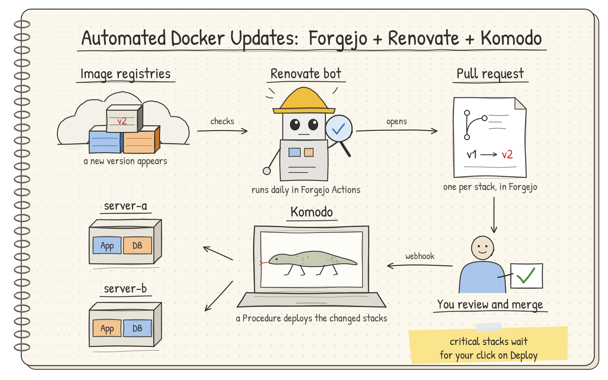

# Automated Docker updates

Somewhere on your server lives a `docker-compose.yml` that started small. Today it is hundreds of lines long. Half of the services run, a few are commented out "for now", one has a name that nobody remembers, and the image tags say `latest` in the hope that it all still works after the next pull. You would like to make sense of it all, see every update before it lands, and get back to a known state when an update goes wrong.

This guide turns that file into a GitOps setup. GitOps means that a Git repository describes what runs, and every change goes through a reviewed commit. At the end, you have this loop:

1. Renovate runs every day in Forgejo Actions and checks the image registries for new versions.
2. For each new version, Renovate opens a pull request in Forgejo, one for each stack. A stack is a small group of containers in one compose file.
3. You review the pull request and merge it.
4. The merge sends a webhook to Komodo. A Komodo Procedure deploys only the stacks that changed.
5. Critical stacks, such as the reverse proxy and Forgejo itself, wait for your click on Deploy.

To roll back an update, you revert its merge commit, and Komodo deploys the old image again. Once a week, a backup of every stack keeps the data of your stacks safe as well.

## The example setup

The guide uses two servers as the worked example. Your setup can have one server or more. Wherever the guide names `server-b`, leave those steps out if you have only one server.

| | `server-a` | `server-b` |
| --- | --- | --- |
| Role | Main Docker host, runs Komodo Core | Runs Forgejo and its runner |
| Where | Home LAN | A VPS with a public address |
| Operating system in the example | Oracle Linux 10 | Ubuntu 22.04 |
| Reverse proxy | SWAG | SWAG |

Both servers start with one large compose file, `/home/docker-compose.yml`, and env files in `/home/.env_files`. If your files are somewhere else, change the paths in the commands and in the Periphery mounts of the two Komodo compose files. Docker names a compose project after the folder of its file, so a file in `/opt/docker` belongs to the project `docker`, not `home`.

## Adapt to your layout

A stack is critical if the Git pull of a Deploy, the webhook or a Periphery connection goes through it. A critical stack stays out of the Procedures, so that a merge never restarts it by itself. If Forgejo cannot be reached while the stack is stopped, the stack also needs the compose-first move of [Critical stacks and recovery](critical-stacks.md).

| Your layout | Route to Komodo through the proxy | Critical stacks |
| --- | --- | --- |
| Komodo at home, Forgejo on a VPS (the example) | `/listener/` and `/ws/periphery` from the VPS only, the web interface from the LAN only | The proxy at home, and the proxy and Forgejo on the VPS |
| One server with Komodo and Forgejo | Not needed. Forgejo calls Komodo on the LAN address. | The proxy and Forgejo |
| Komodo and Forgejo at home, a VPS with Periphery only | `/ws/periphery` from the VPS only. Forgejo calls Komodo on the LAN address. | The proxy and Forgejo at home |

!!! warning "Forgejo blocks webhooks to private addresses"
    When Forgejo calls Komodo on a LAN address, such as `http://<server-a-lan-ip>:9120/listener/...`, the delivery fails, because Forgejo allows only external webhook targets by default. Set `ALLOWED_HOST_LIST = private` in the `[webhook]` section of `app.ini`, or the environment variable `FORGEJO__webhook__ALLOWED_HOST_LIST=private` on the Forgejo container.

The example uses SWAG. With another reverse proxy, such as Traefik, Caddy or Nginx Proxy Manager, the route to Komodo must do the same five things:

1. Serve the web interface (`/`) to your LAN only, over HTTPS.
2. Let `/listener/` through only from the address that Forgejo calls from.
3. Let exactly `/ws/periphery` through, with the WebSocket upgrade, only from the servers that run a remote Periphery.
4. Deny every other path and address.
5. Send all of it to Core on `<server-a-lan-ip>:9120`.

The proxy must also look up container names at each request, not only when it starts, or a route breaks after a stack moves (see [Lessons learned](lessons.md#a-route-returns-502-after-a-move)).

!!! warning "Komodo Core on a host with a public address"
    The Komodo compose file publishes port `9120` on every address of the host. At home behind a router, that port stays on the LAN. On a VPS or any host with a public address, bind it to a private address (`<server-a-lan-ip>:9120:9120`) or block it in the firewall, or the web interface is on the internet over plain HTTP.

## How to read the commands

The commands use placeholders in angle brackets. Replace each one with your own value before you run the command. A command with a placeholder left in it fails, because the shell reads `<` and `>` as redirections.

| Placeholder | Meaning |
| --- | --- |
| `server-a`, `server-b` | The names of your servers. They are also folder names in the repository. |
| `<server-a-public-ip>`, `<server-b-public-ip>` | The public IP address of each server. |
| `<server-a-lan-ip>` | The LAN address of `server-a`. If your `server-b` is on your LAN too, use `<server-b-lan-ip>` in the same way. |
| `<lan-subnet>` | Your LAN, for example `10.10.0.0/24`. |
| `<your-domain>` | Your domain. |
| `<forgejo-host>`, `<komodo-host>` | The host names of Forgejo and Komodo, for example `git.<your-domain>`. |
| `<your-user>` | Your user name in Forgejo. |
| `<your-repo>` | The name of your repository in Forgejo. |
| `<github-user>` | Your GitHub user name, for the optional GitHub token of Renovate. |
| `<procedure-id>` | The ID of a Komodo Procedure, from its page in Komodo. |
| `<dns-server-ip>` | The address of your DNS server, for example a Pi-hole. |

Unless a step says otherwise, run the server commands in a root shell.

## The parts

Do the parts in this order. Each part ends in a working state.

1. [Prerequisites](prerequisites.md): the tools, and a private repository in Forgejo.
2. [Back up and record](backup.md): a backup, and a record of what runs today.
3. [Komodo](komodo.md): Komodo Core, Periphery, and a restricted route through SWAG.
4. [Move the stacks](move-stacks.md): split the large file into stacks, one at a time.
5. [Critical stacks and recovery](critical-stacks.md): the proxy and Forgejo, and how to start things without Komodo.
6. [Webhooks](webhooks.md): a merge deploys the changed stacks.
7. [Renovate](renovate.md): pull requests for new images.
8. [Daily use](daily-use.md): merge, check, roll back, reboot.
9. [Weekly backups](backups.md): a restic backup of every stack, one stopped stack at a time.
10. [Lessons learned](lessons.md): the traps that cost time.
11. [Scripts](scripts.md): every script and configuration file in full.

!!! note "What this guide does not cover"
    It does not install Forgejo, SWAG or Docker. It expects that they run already, as services in your large compose file or elsewhere.
