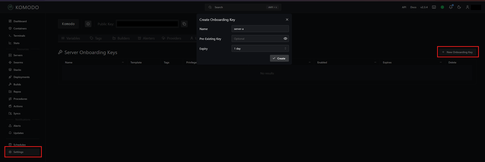

# Komodo

Komodo deploys the stacks from Git. It has three parts:

- Core is the Komodo server and web interface.
- Mongo is the database that stores all Komodo configuration, including secret Variables.
- Periphery is the agent that runs `docker compose` on a server. Each server runs one.

Core, Mongo and the Periphery of `server-a` run in their own compose project, named `komodo`. Komodo never manages this project, so a mistake in Komodo cannot stop Komodo itself. The compose files are on the [Scripts](scripts.md) page: `komodo/docker-compose.yml` for `server-a` and `komodo/periphery-server-b/docker-compose.yml` for `server-b`.

## Start Komodo on server-a

Do these steps on `server-a`.

!!! note "If your large compose file already runs Komodo"
    Remove those services first, so that the new install starts clean. Write a first stack map `tools/stacks/server-a.json` in the server's clone that holds only `{"stacks": {}, "skip": ["komodo-core", "komodo-mongo", "komodo-periphery"]}`, with the service names of your Komodo. [Move the stacks](move-stacks.md#write-the-stack-map) fills in the rest later. Stop and remove the Komodo containers, and write the large file without them with `python3 -I tools/split_stacks.py --server server-a --compose /home/docker-compose.yml --remove skip > work/compose-without-komodo.yml`. Compare the two files with `diff`, then copy the new one over `/home/docker-compose.yml`. Rename the old data folder instead of deleting it, until the new install works.

1. Get the latest repository files:

    ```bash
    cd /root/<your-repo> && git pull
    ```

2. Make the data folders:

    ```bash
    mkdir -p /home/komodo/mongo/db /home/komodo/mongo/config /home/komodo/keys /home/komodo/backups /home/komodo/periphery
    ```

3. Make the env file. The command generates random values, and only root can read the file:

    ```bash
    (umask 077; printf '%s\n' "KOMODO_DATABASE_USERNAME=komodo" "KOMODO_DATABASE_PASSWORD=$(openssl rand -hex 24)" "KOMODO_INIT_ADMIN_USERNAME=admin" "KOMODO_INIT_ADMIN_PASSWORD=$(openssl rand -hex 16)" "KOMODO_WEBHOOK_SECRET=$(openssl rand -hex 32)" "KOMODO_JWT_SECRET=$(openssl rand -hex 32)" > /home/.env_files/.komodo.env)
    ```

    `komodo/compose.env.example` lists the same names without values. Never commit the real file.

4. Log in to Docker Hub with your user name and the read-only token as the password, so that pulls are not limited:

    ```bash
    docker login
    ```

5. Start the project:

    ```bash
    docker compose -f komodo/docker-compose.yml --env-file /home/.env_files/.komodo.env up -d
    ```

    If the command fails, run it again after you fix the cause. Do not make the env file again, because Mongo keeps the first password.

6. Show the containers. All three must be up:

    ```bash
    docker compose -f komodo/docker-compose.yml --env-file /home/.env_files/.komodo.env ps
    ```

7. Show the HTTP status of Core. It must be `200`:

    ```bash
    curl -s -o /dev/null -w '%{http_code}\n' http://127.0.0.1:9120
    ```

8. Count the fatal lines in the Mongo log. The count must be `0`:

    ```bash
    docker logs komodo-mongo 2>&1 | grep -c '"s":"F"'
    ```

9. Show the admin login. Do not share this output:

    ```bash
    grep KOMODO_INIT_ADMIN /home/.env_files/.komodo.env
    ```

10. Sign in at `http://<server-a-lan-ip>:9120` with that login, and keep the password in your password manager.
11. Open Servers. The server `server-a` must show the status OK.
12. Restart the project, then do steps 6 to 8 again and look at the server status again. The results must be the same:

    ```bash
    docker compose -f komodo/docker-compose.yml --env-file /home/.env_files/.komodo.env restart
    ```

## Back up the Komodo database

Komodo keeps its secret Variables in Mongo, so this backup is not optional. A new install creates a Procedure named Backup Core Database. A Procedure is a saved list of Komodo actions. This one runs every day and keeps the last backups in `/home/komodo/backups`. The backups are not encrypted, so keep them readable by root only.

1. Limit access to the backup folder:

    ```bash
    chmod 700 /home/komodo/backups
    ```

2. In Komodo, open Procedures, open Backup Core Database, and click Run.
3. Make sure that a folder with the current date and time is there:

    ```bash
    ls -la /home/komodo/backups
    ```

### Test a restore

Restore the latest backup into a separate test database. This does not change the live database.

```bash
docker exec -e KOMODO_CLI_DATABASE_TARGET_ADDRESS=mongo:27017 -e KOMODO_CLI_DATABASE_TARGET_USERNAME=komodo -e KOMODO_CLI_DATABASE_TARGET_PASSWORD="$(grep '^KOMODO_DATABASE_PASSWORD=' /home/.env_files/.komodo.env | cut -d= -f2)" -e KOMODO_CLI_DATABASE_TARGET_DB_NAME=komodo-restore komodo-core km database restore -y
```

Then delete the test database:

```bash
docker exec komodo-mongo mongosh --quiet -u komodo -p "$(grep '^KOMODO_DATABASE_PASSWORD=' /home/.env_files/.komodo.env | cut -d= -f2)" --authenticationDatabase admin komodo-restore --eval 'db.dropDatabase()'
```

??? warning "A real restore"
    A restore does not clear the target database, so a real restore starts with an empty one. The second command removes all live Komodo data, so run it only for a real restore.

    1. Stop Core and Periphery: `docker stop komodo-periphery komodo-core`
    2. Delete the database `komodo`:

        ```bash
        docker exec komodo-mongo mongosh --quiet -u komodo -p "$(grep '^KOMODO_DATABASE_PASSWORD=' /home/.env_files/.komodo.env | cut -d= -f2)" --authenticationDatabase admin komodo --eval 'db.dropDatabase()'
        ```

    3. Start Core: `docker start komodo-core`
    4. Run the restore command from the test, with `KOMODO_CLI_DATABASE_TARGET_DB_NAME=komodo`.
    5. Restart Core and start Periphery: `docker restart komodo-core && docker start komodo-periphery`

## A restricted route through SWAG

`server-b` must reach Komodo Core for two jobs. Forgejo sends webhooks to `/listener/`, and the Periphery of `server-b` connects to `/ws/periphery`. The route `komodo/swag/komodo.subdomain.conf` on `server-a` allows those two paths from `<server-b-public-ip>` only. It also serves the web interface at `https://<komodo-host>` to your LAN only, because the copy buttons in Komodo work only over HTTPS. Everything else is denied, so the web interface stays off the internet.

!!! note "Why the LAN rule allows the whole subnet"
    When a device on your LAN opens your public host name, the request goes out to your router and comes back in. SWAG then sees the router's LAN address, not the device's. The rule allows `<lan-subnet>`, which covers both. A request from the internet keeps its own address and is denied.

Do not change a rule to make a test pass. If a test in this section fails, stop and find the cause.

Do these steps on `server-a`.

1. Get the latest repository files:

    ```bash
    cd /root/<your-repo> && git pull
    ```

2. Copy the route to SWAG. The path is the configuration folder of SWAG on your host:

    ```bash
    cp komodo/swag/komodo.subdomain.conf /home/swag/config/nginx/proxy-confs/
    ```

3. Test the nginx configuration. The output must end with `test is successful`:

    ```bash
    docker exec swag nginx -t
    ```

    If the test fails, remove the file and stop. A reload with a bad file can take down every site on SWAG:

    ```bash
    rm /home/swag/config/nginx/proxy-confs/komodo.subdomain.conf
    ```

4. Reload nginx. This does not restart the container:

    ```bash
    docker exec swag nginx -s reload
    ```

### Test the route

1. On `server-b`, show the status of three paths. The first must be any status other than 403, and the other two must be 403:

    ```bash
    for p in listener/ "" ws/update; do curl -s -o /dev/null -w "/$p %{http_code}\n" "https://<komodo-host>/$p"; done
    ```

    If the first status is 403, SWAG does not see the address that the rule allows. Stop and find the cause. The usual causes:

    - `server-b` reached `<komodo-host>` over IPv6, while the rule allows its IPv4 address. Test with `curl -4`, and add the IPv6 address to the rule if you need it.
    - A CDN or a tunnel sits in front of SWAG, so SWAG sees the address of that service.
    - The public address of `server-b` is not `<server-b-public-ip>`. `curl -s https://1.1.1.1/cdn-cgi/trace | grep ip=` shows it.

    A status of `000` means that the connection failed: the DNS record, the port forward or the certificate is missing (see [Prerequisites](prerequisites.md#what-you-need)).

2. On a phone, turn off Wi-Fi so that it uses mobile data. Open these addresses. The first three must show 403 Forbidden, and the last must fail to connect:

    - `https://<komodo-host>/listener/`
    - `https://<komodo-host>/`
    - `https://<komodo-host>/ws/periphery`
    - `http://<server-a-public-ip>:9120`

## Connect server-b

The Periphery of `server-b` connects out to Core through the route. It uses an onboarding key one time, and after that its own generated key.

1. In Komodo, create a Server Onboarding Key and copy it. Komodo shows the key only once.

    

    /// caption
    Settings, then Onboarding, then New Onboarding Key. Komodo shows the key after you click Create.
    ///

2. On `server-b`, get the latest repository files and make the data folders:

    ```bash
    cd /root/<your-repo> && git pull && mkdir -p /home/komodo/keys /home/komodo/periphery
    ```

3. Make the env file, readable only by root, and open it in an editor, so that the key stays out of your shell history:

    ```bash
    install -m 600 /dev/null /home/.env_files/.komodo-periphery.env && nano /home/.env_files/.komodo-periphery.env
    ```

4. Add this line with your key, and save the file:

    ```text
    PERIPHERY_ONBOARDING_KEY='your key here'
    ```

5. Start Periphery, and read its log. The log must show that onboarding was successful:

    ```bash
    docker compose -f komodo/periphery-server-b/docker-compose.yml up -d && sleep 10 && docker logs komodo-periphery --tail 20
    ```

6. In Komodo, open Servers. The onboarding adds `server-b` to the list. It must show the status OK, with all of its containers.
7. Remove the key from the file, and recreate Periphery without it:

    ```bash
    truncate -s 0 /home/.env_files/.komodo-periphery.env && docker compose -f komodo/periphery-server-b/docker-compose.yml up -d --force-recreate
    ```

8. In Komodo, make sure that `server-b` shows OK again, then delete the onboarding key.

!!! tip "Periphery sees the host paths"
    Periphery runs Compose inside its own container. Two mounts in its compose file make that work: the root directory `/home/komodo/periphery` has the same path inside and outside, and `/home/.env_files` is mounted read-only, so that the stacks can read their env files.
