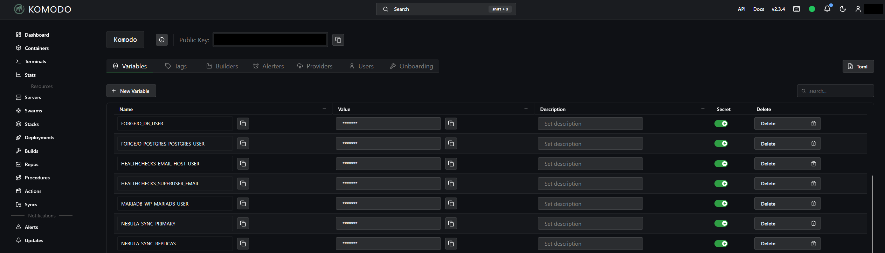
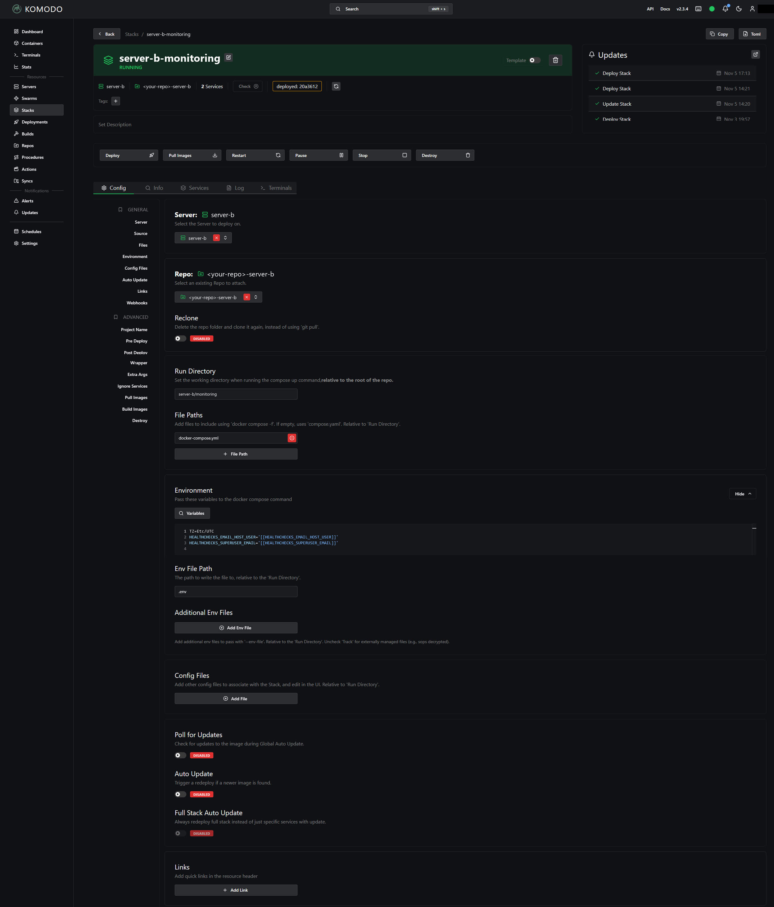

# Move the stacks

This part splits the large compose file into one folder per stack and moves the stacks into Komodo, one at a time. Each move proves that the containers kept their images and their environment. On the server that runs Forgejo, the proxy and Forgejo wait for the [next part](critical-stacks.md). A critical stack on another server, such as the proxy on `server-a`, moves with the steps on this page. But it stays out of the Procedures later.

In Komodo, a Stack is the resource for one compose file. Its name has the server as a prefix, such as `server-a-media`, because a stack name such as `proxy` or `monitoring` can exist on both servers. Its project name in Docker is the stack name alone, such as `media`.

## Write the stack map

The stack map `tools/stacks/server-a.json` tells `split_stacks.py` which service belongs to which stack, and which values are secrets. Write one map for each server in the server's clone, then commit and push it:

```bash
git add tools/stacks/server-a.json && git commit -m "Add the stack map of server-a" && git push
```

```json
{
  "stacks": {
    "proxy": ["swag"],
    "media": ["sonarr", "sonarr-db", "radarr"],
    "monitoring": ["uptime-kuma"]
  },
  "skip": ["komodo-core", "komodo-mongo", "komodo-periphery"],
  "secret_keys": ["DB_PASSWORD", "POSTGRES_PASSWORD", "POSTGRES_USER", "API_TOKEN"],
  "secret_flags": ["--requirepass"],
  "scan_exempt_keys": ["POSTGRES_USER"],
  "plain_env": {"TZ": "Etc/UTC", "PUID": "1000", "PGID": "1000"},
  "network": {"key": "lab.docker", "name": "home_lab.docker"},
  "komodo_files": ["komodo/docker-compose.yml"]
}
```

| Key | What to put in it |
| --- | --- |
| `stacks` | Each stack and its services. Every live service of the large file must be in one stack or in `skip`. A service that needs another one through `depends_on` or `links` must be in the same stack. |
| `skip` | Services that stay out of every stack, such as Komodo itself. |
| `secret_keys` | The keys that `find_literals.sh` marked `LITERAL` and that hold secrets. Each value moves to a variable, and the real value goes to the secrets file. |
| `secret_flags` | Command-line flags with a secret value, such as `redis-server --requirepass`. |
| `scan_exempt_keys` | Secret keys whose value also appears as normal text, such as a database user named like its service. The leak scan skips them. Usernames are the usual case. |
| `plain_env` | Values that are not secret but that the files use as `${VARIABLES}`, such as `TZ`. |
| `network` | The shared Docker network. `key` is the name under `networks:` in your services, and `name` is the real network name, which you see with `docker network ls`. A project in `/home` names it `home_<key>`. |
| `komodo_files` | The compose files outside the stack folders whose containers run on this server, so that `check_images.py` compares them too. On `server-b`, it is `["komodo/periphery-server-b/docker-compose.yml"]`. |

!!! tip "Group by what restarts together"
    Put an application and its database and cache in the same stack. A Deploy recreates only the services whose configuration changed, so a bigger stack does not mean more restarts.

## Prepare Komodo

Do steps 1 to 3 one time. Do steps 4 and 5 for each server.

1. In Forgejo, create a personal access token for Komodo with read access to repositories only.
2. In Komodo, open Settings, then Providers, and add a git account: the domain `<forgejo-host>`, HTTPS on, the user `<your-user>`, and that token.
3. On the same page, add a Docker registry account for `docker.io` with a read-only Docker Hub token. Periphery runs in a container, so it cannot use a `docker login` of the host.
4. Open Repos, and create a Repo named `<your-repo>-server-a`: Server `server-a`, git provider `<forgejo-host>`, account `<your-user>`, repo `<your-user>/<your-repo>`, branch `main`.
5. Click Clone on the Repo. The clone must finish without an error.

Komodo keeps this clone at `/home/komodo/periphery/repos/<your-repo>-server-a` on the server.

## Generate the stack files

Do these steps on `server-a`.

1. Get the latest repository files, and generate the stack files and the secrets file:

    ```bash
    cd /root/<your-repo> && git pull && python3 -I tools/split_stacks.py --server server-a --compose /home/docker-compose.yml --out server-a --secrets-file /root/secrets-server-a.env
    ```

    The output shows how many stack files it wrote. If the tool stops with `secret values found in the output`, do not commit anything. A secret value is also on another line of a stack file, for example a password that is the same as a user name. Change that password, then run the step again. The message names variables, never values, so you can share it.

    ??? note "Other errors of the split, and their fixes"

        | Message | Fix |
        | --- | --- |
        | `service X is not in any stack` | Add X to a stack or to `skip` in the map. |
        | `service X is listed more than once in the map` | Keep X in one stack only. |
        | `X (stack A) needs Y (stack B) through depends_on` | Put X and Y in the same stack. |
        | `no pin for service X` | Add X to `tools/pins/server-a.json`. |
        | `X has a relative path under volumes` | Use an absolute path (see [Prepare the large file](backup.md#prepare-the-large-file)). |
        | `value mixes text with a variable or a bare $` | A secret such as `postgres://user:${PW}@db` cannot move as one value. Move the whole value into one variable, or remove the key from `secret_keys`. |
        | `X uses unknown network Y` | Put the service on the network of the map, or fix `network` in the map. |
        | `map has no network, but X uses Y` | Add `network` to the map. |

2. Count the secrets that hold a space before a `#`. Komodo cuts an Environment line at ` #`, so such a secret does not reach the container. The command must print `0`:

    ```bash
    grep -c ' #' /root/secrets-server-a.env
    ```

3. Choose the first stack. A small stack with few users is a good pilot. The examples use `media`. List its sensitive-looking keys. No line can show `LITERAL`, except keys that you know are not secret:

    ```bash
    bash tools/find_literals.sh < server-a/media/docker-compose.yml
    ```

4. Read the stack file. Make sure that it holds no password or token, and that each image has a digest:

    ```bash
    cat server-a/media/docker-compose.yml
    ```

5. Commit and push this one stack only. Leave the other generated stacks uncommitted for now:

    ```bash
    git add server-a/media && git commit -m "Add the media stack" && git push
    ```

6. In Komodo, click Pull on the Repo `<your-repo>-server-a`.

## Create the Stack

1. Print the Environment text of the stack:

    ```bash
    python3 -I tools/split_stacks.py --server server-a --compose /home/docker-compose.yml --out server-a --secrets-file /root/secrets-server-a.env --print-env media
    ```

    Plain values show as `NAME=value`. Secrets show as `NAME='[[NAME]]'`, which Komodo fills from a secret Variable of that name.

2. Show the real values of this stack's secrets. Do not share this output. If it shows nothing, the stack has no secrets:

    ```bash
    python3 -I tools/split_stacks.py --server server-a --compose /home/docker-compose.yml --out server-a --secrets-file /root/secrets-server-a.env --print-env media | grep -F "='[[" | sed "s/=.*/=/;s/^/^/" | grep -f - /root/secrets-server-a.env
    ```

3. In Komodo, open Settings, then Variables. Create one Variable for each line, with the secret option on. Use the name before `=` and the text between the outer single quotes as the value, exactly as shown.

    

    /// caption
    Variables with the secret option on. Komodo hides their values in the page and in the logs.
    ///

    !!! warning "Variables are shared by all servers"
        A Variable name is the service name and the key, such as `SONARR_DB_DB_PASSWORD`. If a service with the same name exists on both servers, both use one Variable. Before you create one, make sure that no Variable of that name exists. If it exists with another value, rename one of the services in the large file first.

4. Open Stacks and create a Stack named `server-a-media`:

    - Server: `server-a`
    - Source: the Repo `<your-repo>-server-a`
    - Run Directory: `server-a/media`
    - File Paths: `docker-compose.yml`
    - Project Name: `media`
    - Image Registry: `docker.io`, with your Docker Hub account
    - Environment: the text from step 1

    

    /// caption
    A normal Stack on `server-b`. On `server-a`, the names say `server-a` instead. Project Name and Image Registry are farther down the page.
    ///

5. Make sure that Auto Update and Poll For Updates are off. Auto Update can change an image without a pull request, which is what this whole setup avoids.

Do not click Deploy yet.

## Before the move

1. Make sure that Periphery can read the env files of the stack. The command shows one line for each env file, and no error. It shows names and permissions only:

    ```bash
    grep -o '/home/.env_files/[^" ]*' server-a/media/docker-compose.yml | sort -u | xargs -r docker exec komodo-periphery ls -l
    ```

2. Make sure that no SWAG file sends traffic to a container of the stack by a fixed name. A move recreates the containers, and a container can get a new IP address. nginx looks up a fixed name only when it starts or reloads, so the route then returns 502. This lists the files that use a fixed name:

    ```bash
    docker exec swag sh -c 'grep -l -E "proxy_pass\s+https?://[A-Za-z]" /config/nginx/proxy-confs/*.conf /config/nginx/site-confs/*.conf 2>/dev/null'
    ```

    A file in the list that sends traffic to a container of the stack needs the variable form: `include /config/nginx/resolver.conf;`, then `set $upstream_app`, `set $upstream_port` and `set $upstream_proto`, then `proxy_pass $upstream_proto://$upstream_app:$upstream_port;`. A file that sends traffic to a LAN host name or an IP address does not need it.

## Move the containers

The application is down from step 3 until the Deploy finishes.

1. Record the state:

    ```bash
    bash tools/collect_state.sh > work/before-media.txt
    ```

2. Keep a copy of the large compose file:

    ```bash
    cp /home/docker-compose.yml work/compose-before-media.yml
    ```

3. Stop and remove the containers of this stack only. Use the container names, which `docker ps` shows:

    ```bash
    docker stop sonarr sonarr-db radarr && docker rm sonarr sonarr-db radarr
    ```

4. Write the large file without this stack, and put it in place. This does not restart a container:

    ```bash
    python3 -I tools/split_stacks.py --server server-a --compose /home/docker-compose.yml --remove media > work/compose-after-media.yml && cp work/compose-after-media.yml /home/docker-compose.yml
    ```

5. In Komodo, open the Stack `server-a-media` and click Deploy. Every stage must succeed. In the Compose Up stage, each container of the stack shows `Created` and then `Started`.

## Make sure that the move worked

1. Record the state after the move:

    ```bash
    bash tools/collect_state.sh > work/after-media.txt
    ```

2. Compare the image IDs (field 3), the start times (field 8) and the environment hashes (field 9):

    ```bash
    for f in 3 8 9; do diff <(cut -d'|' -f1,$f work/before-media.txt) <(cut -d'|' -f1,$f work/after-media.txt); echo "field $f done"; done
    ```

    - Field 3 must show nothing, because a move never changes an image.
    - Field 8 can show only the containers of this stack.
    - Field 9 must show nothing. If a line appears, a variable changed or is missing. Compare the Komodo Variables with the secrets file, and read the Environment of the Stack. Do not move the next stack until this is clear.

3. Open the application and make sure that your data is there.

## If the deploy fails

A failed move goes back to the old project. Use the pinned stack file for this, not the old large file. Some old tags point to newer images by now, so the old file can change an image.

1. In Komodo, click Destroy on the Stack. Destroy runs `docker compose down` for the stack: it stops and removes its containers. The data in the bind mounts stays.
2. Put back the large compose file:

    ```bash
    cp work/compose-before-media.yml /home/docker-compose.yml
    ```

3. Make a temporary env file with the plain values of your map and the secrets. Only root can read it:

    ```bash
    (umask 077; { printf 'TZ=Etc/UTC\nPUID=1000\nPGID=1000\n'; cat /root/secrets-server-a.env; } > work/rollback.env)
    ```

4. Start the containers in the old project. `home` is the project name of the large file, which `docker compose ls` shows:

    ```bash
    docker compose -p home -f server-a/media/docker-compose.yml --env-file work/rollback.env up -d
    ```

    Compose warns about `orphan containers`, because this file holds only one stack of the old project. Ignore the warning. Do not add `--remove-orphans`, which removes the containers of every other stack in the old project.

5. Delete the temporary env file, and do "Make sure that the move worked" again. The start times change, but the image IDs must not:

    ```bash
    rm work/rollback.env
    ```

## The other stacks

Move the remaining normal stacks the same way, one at a time. Start each one at "Generate the stack files". You can stop between any two stacks. Stop at the first result that you do not expect.

- A stack that moved shows as `already migrated and kept` in the output of the split. The two numbers add up to the number of stacks in the map.
- For `server-b`, use `--server server-b`, `/root/secrets-server-b.env`, the folder `server-b/`, the Stack names `server-b-<stack>`, and a second Repo `<your-repo>-server-b` with the Server `server-b`.
- If a stack holds your DNS server, make sure that the host itself does not use that DNS server during the move. The Deploy must reach the image registry while the container is stopped.
- After the last stack of a server, search the whole repository history for the secret values of that server. Every hit is a secret that reached Git. Change such a secret, because every clone keeps it:

    ```bash
    python3 -I tools/scan_repo_secrets.py --repo /root/<your-repo> /root/secrets-server-a.env --env-dir /home/.env_files
    ```

- Keep the secrets file until no more moves or rollbacks are planned. The rollback steps above read it, and so does `--print-env`.

??? note "Add services to a stack that moved already"
    Add the new services to the stack in the map, and add their pins to `tools/pins/server-a.json`. If the tool wrote a folder for them before as a stack of their own, delete that uncommitted folder. Then generate the stack files again. The tool adds the new services to the existing stack file and leaves its other lines as they are. So `git diff --numstat server-a/media` shows `0` removed lines. Create Variables only for the new secrets, replace the whole Environment of the Stack with the new `--print-env` text, and move only the new containers. If that Deploy fails, do not click Destroy, because Destroy removes the whole stack. Remove only the new containers, and start them in the old project with the rollback steps above. Name the services at the end of the `docker compose up -d` command.

??? note "Make a key secret after its stack moved"
    Add the key to `secret_keys`, push the map, and generate the stack files again. After the large file is retired, use `--compose /home/docker-compose.yml.retired`. The tool also extracts secrets in the files of stacks that moved. It changes only the lines of the new key, adds the value to the secrets file, and ends its output with `, 1 of them with new secrets`. Commit the stack file, and Pull the Repo in Komodo. Create the new secret Variable, replace the Environment of the Stack with the new `--print-env` text, and Deploy. The image IDs and environment hashes must not change, because the value did not change.

    If you deleted the secrets file, the tool writes a new one with only the new value. `--print-env` then stops with `is not plain or a secret` for the other secrets. In that case, add only the line `NAME='[[NAME]]'` of the new Variable to the Environment of the Stack. Delete the new secrets file after the Variable exists.
