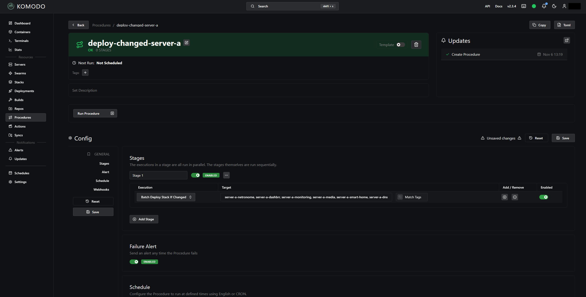
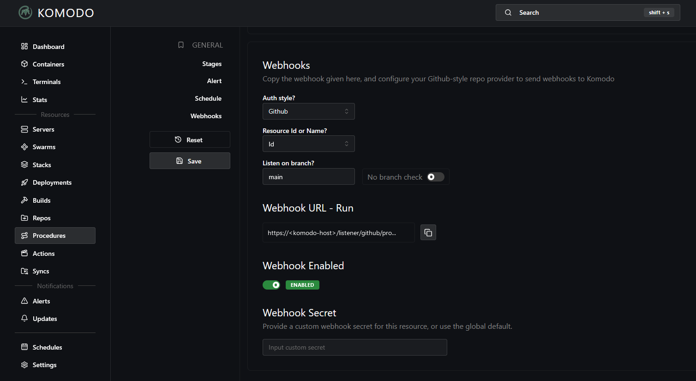

# Webhooks

After this part, a push to `main` deploys the changed stacks by itself. Each server gets one Komodo Procedure and one Forgejo webhook. The Procedure deploys only the stacks of its server whose files changed since their last Deploy. The critical stacks are in neither Procedure, so you always deploy them with a click.

## Create the Procedures

Do these steps in Komodo, for each server.

1. Open Procedures and create a Procedure named `deploy-changed-server-a`.
2. Add one stage. Set its execution to `BatchDeployStackIfChanged`.
3. Set the pattern of the stage to the names of the normal Stacks of that server, separated by commas, for example `server-a-media, server-a-monitoring, server-a-dns`. Name each Stack. Do not use a wildcard, so that the pattern can never match a critical stack.
4. Click Save. A stage that you add or change has no effect until you save the Procedure.
5. Open the webhook section of the Procedure, and turn the webhook on for the branch `main`. Copy the webhook URL that Komodo shows. It has the form `https://<komodo-host>/listener/github/procedure/<procedure-id>/main`.



/// caption
The stage of the Procedure for `server-a`. The target names each normal Stack.
///


/// caption
The webhook section of the same Procedure. The button next to the URL copies it.
///

The Procedure pulls the Repo itself before it compares, so after a merge you do not click Pull. When you add a stack to Komodo later, add its name to the pattern of the Procedure for its server, and click Save.

## Turn off the other webhooks and schedules

Only the two Procedures accept webhooks. Everything else that can deploy without a pull request is off:

- On each Stack and each Repo, turn off the webhook, and on each Stack also Auto Update and Poll For Updates. Click Save.
- Komodo creates three Procedures of its own. Keep Backup Core Database and Rotate Server Keys on. Turn off the schedule of Global Auto Update, because it updates every Stack that has Auto Update or Poll For Updates on, without a pull request.

## Create the webhooks in Forgejo

In Forgejo, open `<your-user>/<your-repo>`, then Settings, then Webhooks, and add one Forgejo webhook for each Procedure:

| Field | Value |
| --- | --- |
| Target URL | The webhook URL of the Procedure, `https://<komodo-host>/listener/github/procedure/<procedure-id>/main` |
| HTTP method | `POST` |
| Content type | `application/json` |
| Secret | The value of `KOMODO_WEBHOOK_SECRET` in `/home/.env_files/.komodo.env` on `server-a` |
| Trigger on | Push events only |
| Branch filter | `main` |


Komodo uses its `github` listener for Forgejo, because Forgejo signs each call in the same way as GitHub. The restricted route of the [Komodo](komodo.md#a-restricted-route-through-swag) part lets `/listener/` through from `server-b` only, and Forgejo runs on `server-b`.

## What a push does

| Change on `main` | Result |
| --- | --- |
| A stack in a Procedure changed | Komodo deploys that stack. Compose recreates only the services whose settings changed. A change to a comment restarts nothing. |
| Stacks on both servers changed | Each Procedure deploys the changed stacks of its own server. |
| A critical stack changed | Nothing deploys. Komodo shows the stack as changed. Review the change, then click Deploy on the Stack. |
| No stack changed | Nothing deploys. |

A push to any other branch does nothing. The branch filter in Forgejo stops the call, and the URL names `main` too.

## Make sure that a webhook works

1. Push a commit that changes only a comment in one normal stack file.
2. In Forgejo, open the webhook. The newest delivery must have a green check. Test delivery sends the newest commit on `main` again, so it deploys nothing new.
3. In Komodo, open the Procedure. The delivery must start one run. The log lists every stack of the pattern. A stack that Komodo deploys takes a few seconds, and a stack with no change takes less than a second. The run must end with `The procedure has completed with no errors`.
4. On `server-a`, show the newest webhook calls in the SWAG log. Each line must show `<server-b-public-ip>` and the status `200`:

    ```bash
    docker exec swag sh -c 'grep "/listener/" /config/log/nginx/access.log | tail -n 4'
    ```

    A status of `403` means that SWAG blocked the call. A status of `401`, or an error about the signature, means that the secret in Forgejo differs from `KOMODO_WEBHOOK_SECRET`.

5. Push a commit that removes the test comment again. No container restarts.

Also test the other cases once: a comment in a critical stack deploys nothing, and a push to another branch starts no delivery.

!!! note "Many stacks in one Repo"
    A Komodo issue, [moghtech/komodo#769](https://github.com/moghtech/komodo/issues/769), reports that batch actions can fail with `Missing compose file` when many stacks share one Repo. The reports are about 10 to 50 or more stacks. If a run shows this error, deploy the stacks one at a time, and look at the issue before you add more stacks to the Procedure.
