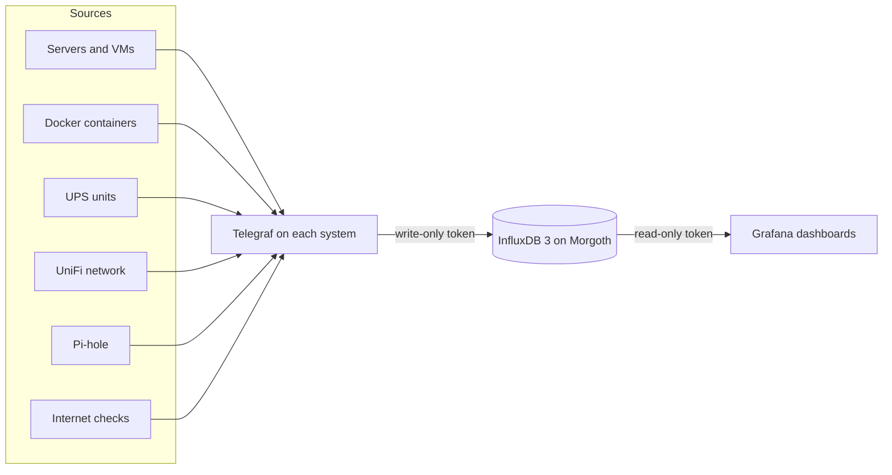

# Monitoring

This page is part of my [Primary Lab](index.md).

A metric is a number that a system reports again and again, such as the CPU use or the temperature of a drive. In November 2026, I rebuilt the metrics of the lab from the start. This page explains the design, the versions and what I learned.

## The three programs

- **Telegraf** is the collector. A Telegraf runs on each system that I watch. It reads the numbers and sends them to the database.
- **InfluxDB 3 Enterprise** is the database. It runs in a container on Morgoth and keeps each number for 180 days.
- **Grafana** shows the numbers on dashboards. It also runs on Morgoth.

Each system has its own token, which permits only to write to this one database. Grafana has a token that permits only to read. The NAS is an exception. It uses the token of Suladan until it gets its own. No Telegraf config holds a token. Each config reads it from a variable, and the values are only on the systems and in a password manager.

The Cloud Server is outside the house. Its Telegraf sends through the reverse proxy at home, on a route that accepts only the address of the Cloud Server.

## The versions

These are the versions on November 14, 2026.

| Program | Version | Where |
| --- | --- | --- |
| InfluxDB 3 Enterprise | 3.12.2 | A container on Morgoth, from the image `influxdb:3.12.2-enterprise` |
| Telegraf | 1.40.3 | Containers on Morgoth and Gothmog from the image `telegraf:1.40.3-alpine`, a package on Suladan, a Windows service on Zog, and the release archive on the ReadyNAS |
| Telegraf | 1.35.3 | A package on the Cloud Server |
| Telegraf | 1.21.4 | The package of Ubuntu on the PiHole |
| Grafana | 13.3.1 | A container on Morgoth |
| UnPoller | 5.9.5 | A container on Suladan |
| Pi-hole | 6 | Both Pi-holes |

InfluxDB 3 Enterprise runs with the free licence for hobby use at home. This licence permits two CPU cores and does not end. The container is fixed to two cores for this reason.

## What is collected

| Source | How | Examples |
| --- | --- | --- |
| Each server and VM | The system inputs of Telegraf | CPU, memory, disks, network, uptime |
| Docker containers | The `docker` input of Telegraf | CPU and memory of each container, state, restarts, health |
| Drives | The `smart` input, every 5 minutes | Temperature, health, reallocated sectors, cable errors |
| Three UPS units | NUT, the UPS service, read by the `upsd` input | Status, load, power, runtime, battery charge |
| Internet line | Ping to four hops, DNS lookups, and the results of the Netronome speed tests | Latency, packet loss, download and upload speed |
| Public services | A request to each public name, from home and from the Cloud Server | Status code, response time, days until the certificate ends |
| Healthchecks | The API of my Healthchecks instance | The state of each check |
| Pi-hole | A Python script that reads the API of both Pi-holes every 5 minutes | Queries, blocked queries, devices, top domains |
| UniFi network | UnPoller reads the UniFi controller once a minute, and Telegraf reads UnPoller. I keep 128 of its 281 figures. | Devices, clients, ports, traffic, Wi-Fi signal |
| ReadyNAS | Telegraf on the NAS, with a small shell script | RAID arrays, volume errors, drive health, temperatures, fans |

A service is checked from the other side. The Cloud Server checks the names that the house hosts, and the house checks the names that the Cloud Server hosts. A check from the same network as the service does not show a problem of the internet line.

## The dashboards

| Dashboard | Shows |
| --- | --- |
| Overview | One row for each system and each UPS, with a status of up or down |
| Host | One system in detail: CPU, memory, network, disks, drive temperatures, containers |
| Containers | All containers of the Docker hosts, with status, CPU, memory and health |
| Storage | The Unraid arrays, the fullest filesystems, the gap between the media and its backup, all drives |
| UPS | One UPS in detail, with energy and cost |
| Power | The power of all UPS units together, with cost for a day, a month and a year |
| Internet | Speed, delay for each hop, DNS, the public names and the services |
| Pi-hole | Queries, blocking, devices and top lists for both Pi-holes |
| UniFi | The gateway, the switches, the access points, the ports and the clients |
| ReadyNAS | The volume, the arrays, the drives and the fans of the NAS |

Each query is InfluxQL. InfluxDB 3 also accepts SQL.

No dashboard names a system in a query. Each one reads the systems from the database and offers them in a dropdown. A new system shows on the dashboards when its Telegraf starts to write.

## The dashboards are generated

I do not build a dashboard by hand in Grafana. A Python program writes each dashboard file.

1. A generator for each dashboard builds the panels and the queries.
2. A checker reads the file and fails on a broken rule, for example a query that names one system.
3. The checker runs each query against the database and fails on an error or an empty result.
4. I import the file in Grafana.
5. I look at the dashboard at three screen widths, from a small window to a wide monitor.

A test makes sure that each dashboard file is exactly what its generator writes. So the file in the repository and the program that makes it cannot differ.

## What I learned

- **InfluxDB 3 sets the type of a field with the first value.** If a system later sends that field with another type, the database refuses the whole batch of that system. The error shows only in the Telegraf log of that system. An old Telegraf sends some whole numbers with another type than a new one. Telegraf 1.38 and later has the `influxdb_v3` output. For the two older versions, I use the `influxdb_v2` output with `influx_uint_support = true`.
- **Send each point one time.** On one day, my database wrote about 245 GB to its disk for 0.2 GB of data that it kept. In version 3.12.2, each snapshot writes the files of the current UTC day again in full. A point with an old time makes the database write that older day again, too. The default is one snapshot every 10 seconds, and one of my scripts sent the last six hours of results in each run. Now the variable `INFLUXDB3_SNAPSHOT_DURATION` is `5m`, and the script sends the last 15 minutes. The base writes went from 33 MB to 3 MB each minute. My estimate is 15 GB each day, and the measurement of one full day is still open. A query also sees the data that is not yet in a snapshot, so the dashboards have no delay.
- **Do not trust a rate that a device reports.** The port rate figures of UnPoller were about 2.2 times the real rate on two switches, and zero on ports with traffic. I calculate each rate from the byte counters with `non_negative_derivative`.
- **Stale data can look alive.** If the UniFi controller does not answer, UnPoller repeats its last figures. The graphs then look normal. A tile with the age of the data is the only sign.
- **A count of zero can mean "no data".** A tile that counts problems shows zero when its input stops. I put a second tile beside it that counts the items that report.
- **Give each dropdown query a time filter.** A dropdown that lists the systems has `WHERE $timeFilter` in its query. Without it, a system that I removed stays in the list until the retention removes its data.
- **The Telegraf image has no SMART tools.** My Telegraf containers install `smartmontools` and `nvme-cli` at each start. A start without the internet fails, which is a weak point.
- **Compare two databases with a fixed window.** For two days, each Telegraf wrote to the old and the new database. To compare them, I used one window in the past, the same on both sides, with its end between two reads.
- **Put the host name check into each command block.** I once ran a block for one server on another server. Now each block that installs a file stops on the wrong machine.
- **Copy results that exist.** The speed test script only copies the results that Netronome already made. It does not start a test, so it puts no load on the line.

## What is missing

- No alert exists. A dashboard shows a problem only to a person who looks at it.
- The database and Grafana are on one server. If that server is down, no system can store its metrics.
- The data starts in November 2026. I did not keep the data of the old database.
